<div align="center">

# 🤖 Obstacle-Avoiding Wi-Fi Rover

**A small 2WD rover that dodges obstacles on its own. You can also drive it from your phone over Wi-Fi.**

*Built in 3 days at the LUTES Deep Tech Hackathon · Challenge 1 · Oct 9–11, 2026*


<br>

<table>
  <tr>
    <td align="center">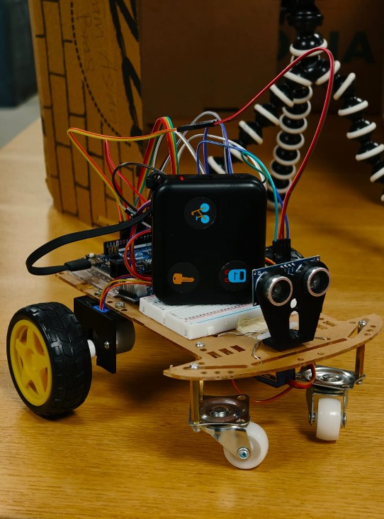<br><sub>Front</sub></td>
    <td align="center">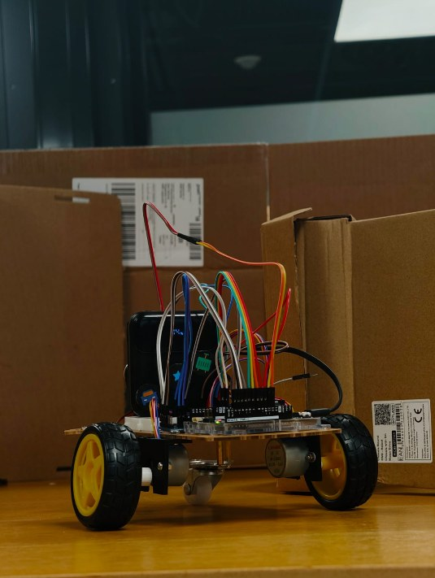<br><sub>Back</sub></td>
  </tr>
  
  <tr>
    
  </tr>
</table>

<br>

### 


[](https://drive.google.com/drive/folders/18OhLk0SzIVRIewPOJ9jgTZvdST5h4VTU)

[](https://drive.google.com/file/d/1humoDalXv7shxewihoUJDhTzp3ChKCxY/view?usp=drivesdk)


<!-- If the video is on YouTube instead, use:
[](https://www.youtube.com/watch?v=YOUTUBE_ID)
-->

</div>

---

## 📌 Overview

The rover drives forward until something gets in its way. Then it looks around with the ultrasonic sensor on a servo "neck" (so it doesn't have to turn its whole body), picks the clearest way and goes. On top of that the Arduino hosts a small web dashboard, so anyone on the same network can switch modes, drive it manually, watch a live radar or shout voice commands at it.

## 📖 The story

After a stressful 3 days, our group, the **AsianBros**, finally made our rover work. We were heavily disadvantaged, since all six of us are 1st and 2nd year BSc computational engineering students. But in the end we actually completed our challenge.

The full saga is in the [log book](#log-book) below.

## ✨ Features

| Mode | What it does |
|---|---|
| 🧭 **Default** | Drives straight until something is in the way, scans 0–180° with the neck servo, picks left, front or right, turns and lines itself up with the sensor. Backs up if it gets stuck. |
| 🧭 **Default 2** | Earlier version of Default: stops at 20 cm and chooses between the same three routes. |
| 🧭 **Default 3** | Finds the middle of the widest gap (at least 45 cm open) and aims straight at it in small steps. |
| 🧱 **Default 4** | Wall follower. Keeps about 23 cm from the wall on its right, checks ahead every 0.8 s and turns at corners. |
| 🎮 **Manual** | Drive forward / back / left / right from the dashboard buttons. |
| 🎯 **Follow** | Locks onto the nearest object in front and follows it at a set distance. |
| 📡 **Radar** | Sweeps the sensor and draws a live radar on the dashboard; stale points fade out after 3 s. |
| ⛔ **Stop** | Stops all motors. |
| 🎙️ **Voice** | Wake word **"rover"** + a command (e.g. *"rover, stop"*). No push-to-talk button needed. |

The dashboard also has sliders for drive and turn speed, a setting for how long a 90° turn takes, and a live speed readout.

## 🧰 Hardware

| Component | Role |
|---|---|
| Arduino UNO R4 WiFi | Brain + Wi-Fi web server (ESP32-S3 radio) |
| 2× 28BYJ-48 stepper motors + ULN2003 drivers | Drive wheels |
| HC-SR04 ultrasonic sensor | Distance measurement (2–400 cm) |
| SG90 servo | Pans the sensor to scan routes |
| 2WD chassis kit + caster | Frame |
| Custom outer shell | Body cover designed in OpenSCAD by the decoration team |
| 2× 18650 cells / USB power bank | Motor and logic power |

### 🔌 Wiring

| Part | Wire | Connects to |
|---|---|---|
| ⚙️ Stepper 1 (ULN2003 board) | IN1 / IN2 / IN3 / IN4 | **D2** / **D3** / **D4** / **D5** |
| ⚙️ Stepper 1 (ULN2003 board) | VCC / GND | breadboard + / − |
| ⚙️ Stepper 2 (ULN2003 board) | IN1 / IN2 / IN3 / IN4 | **D6** / **D7** / **D8** / **D9** |
| ⚙️ Stepper 2 (ULN2003 board) | VCC / GND | breadboard + / − |
| 🔄 Neck servo (SG90) | Brown / Red / Orange | breadboard − / + / **D10** |
| 📡 Ultrasonic sensor (HC-SR04) | VCC / Trig / Echo / GND | breadboard + / **D11** / **D12** / breadboard − |

## 🗂️ Project structure

```
rover/
├── rover.ino                  # setup() and loop()
├── config.h                   # Wi-Fi name, password, fixed IP
├── src/
│   ├── core/
│   │   ├── core.h             # pins, modes, shared state
│   │   ├── motors.cpp         # stepper driving
│   │   ├── sensor.cpp         # ultrasonic sensor, neck servo, speed estimate
│   │   ├── display.cpp        # LED matrix shows the current mode
│   │   └── rover_state.cpp    # current mode and mode names
│   ├── modes/
│   │   ├── modes.h / modes.cpp
│   │   ├── default_mode.cpp
│   │   ├── default2_mode.cpp
│   │   ├── default3_mode.cpp
│   │   ├── default4_mode.cpp
│   │   ├── manual_mode.cpp
│   │   ├── follow_mode.cpp
│   │   └── radar_mode.cpp
│   └── web/
│       ├── web_server.cpp/.h  # Wi-Fi + HTTP server
│       └── dashboard.h        # dashboard page, generated from web/
├── web/                       # dashboard source (HTML / CSS / JS)
├── tools/
│   ├── build_dashboard.py     # packs web/ into src/web/dashboard.h
│   └── sensor_test/           # standalone ultrasonic sensor test
├── backup_stepper/            # day 2 stepper version (prototype 1)
└── _servo_version/            # the 360° servo attempt from day 3 (didn't work)
```

## 🚀 Getting started

**1. Install the toolchain**
- Arduino IDE or `arduino-cli`
- Board package: **Arduino UNO R4 Boards**

**2. Set your Wi-Fi**: edit `WIFI_SSID` and `WIFI_PASS` in `config.h` (network must be **2.4 GHz**).

**3. Build the dashboard** (only after editing files in `web/`)
```bash
python tools/build_dashboard.py
```

**4. Compile & upload**
```bash
arduino-cli compile --fqbn arduino:renesas_uno:unor4wifi .
arduino-cli upload  --fqbn arduino:renesas_uno:unor4wifi -p <PORT> .
arduino-cli monitor -p <PORT> -c baudrate=9600
```

**5. Drive it**: the Serial Monitor prints `Control page: http://...`. Open it in a browser on the same network. If the hotspot isn't found, the rover starts its own network, **RoverAP**.

## 🧠 How Avoid mode works

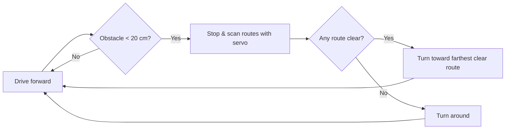

## 🛠️ Challenges we solved

- **Wiring vs. code mismatches**: sensor reading `-1` traced to swapped pins; we fixed one pin map as the single source of truth.
- **Rover seeing itself**: narrowed the scan angle in Follow/Radar so the chassis isn't detected as an obstacle.
- **Jittery servo**: the servo now holds still once a target is locked instead of constantly twitching.
- **Changing IP address**: assigned a fixed IP so the dashboard link stays the same between runs.
- **Motor direction**: flipped the direction constants until the manual controls finally matched what the wheels did.
- **Servos that wouldn't spin**: the 360° servos kept snapping back to their starting position after a tiny turn. We didn't solve this one. We went back to the stepper prototype instead.

<a id="log-book"></a>

## 📓 Log book

> 3 days, 6 people, 1 rover, and a lot of waiting for the 3D printer.

<p align="center">
  
  
  
  
</p>

<details open>
<summary><h3>🟦 Day 1 · Friday 9.10: Figuring out what we got ourselves into</h3></summary>

We spent day 1 understanding the challenge and planning our approach. Mostly we messed around with the parts and tried to get some of them working without the full setup, like the sensor.

| Team | What they did |
|---|---|
| 🔧 Engineering | Started modelling the parts we'd need |
| 🎨 Decoration | Started coming up with design ideas |
| 💻 Software | Started testing code with only some of the hardware connected |

<table>
  <tr>
    <td align="center">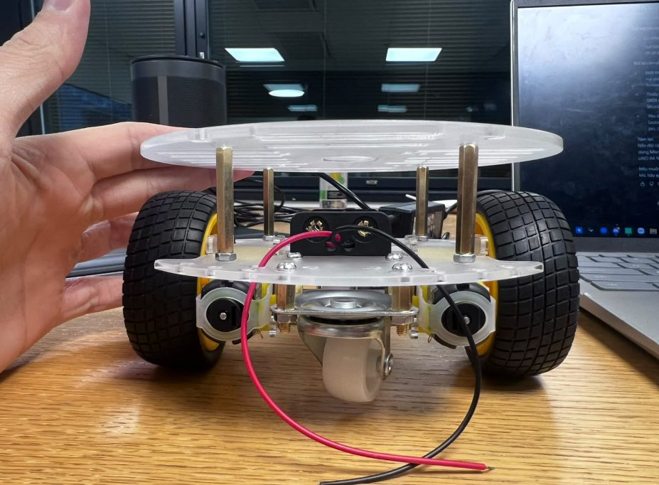<br><sub>Messing around with the chassis</sub></td>
    <td align="center">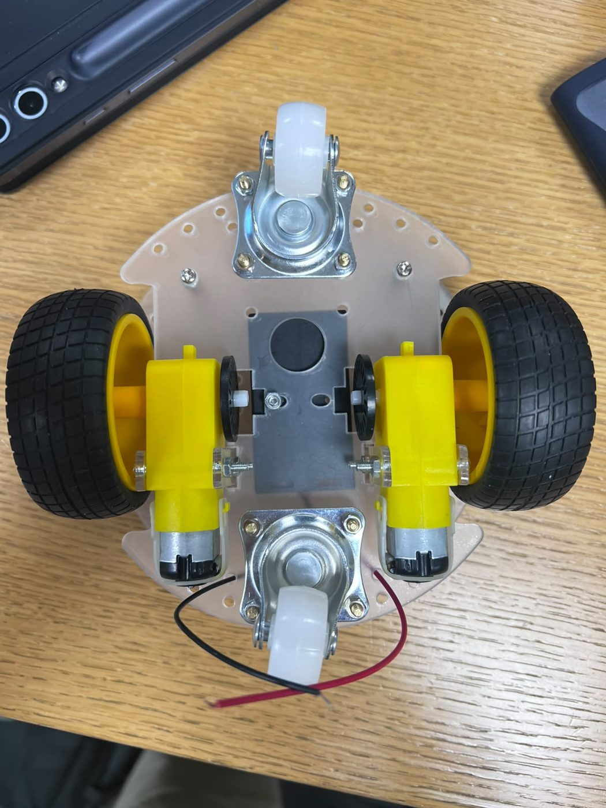<br><sub>Chassis underside</sub></td>
    <td align="center">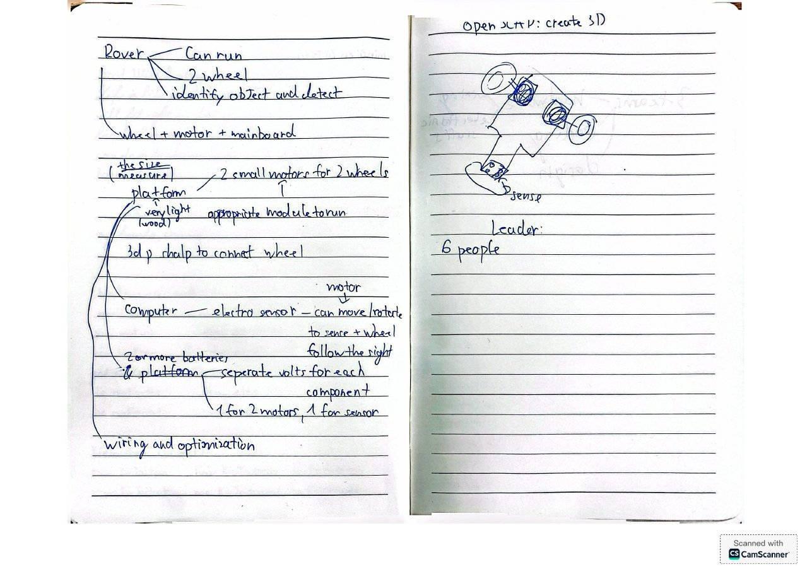<br><sub>Brainstorm notes</sub></td>
  </tr>
</table>
</details>

<details open>
<summary><h3>🟪 Day 2 · Saturday 10.10: Prototype 1 (and then we took it apart)</h3></summary>

On day 2 we started modelling the 3D parts and the body deco. It took the entire day to get our parts printed, and by night we had our first working rover. Except it was extremely slow, because we were using stepper motors. Unfortunately a lot of the good components were limited and already taken, so we had to work with whatever we could get.

Later, another team gave us their extra micro servos that could spin 360°. So naturally we completely dismantled our first prototype and started installing the better servos.

| Team | What they did |
|---|---|
| 🔧 Engineering | Modelled and 3D-printed the parts ([see below](#3d-design)), built prototype 1, then took it apart again for the servos |
| 🎨 Decoration | Modelled the body deco in OpenSCAD ([see below](#3d-design)) |
| 💻 Software | Got the Wi-Fi dashboard and the driving modes working, fixed a sensor that only ever said `-1` (wrong pins, classic), gave the rover a fixed IP and added voice commands |

<table>
  <tr>
    <td align="center">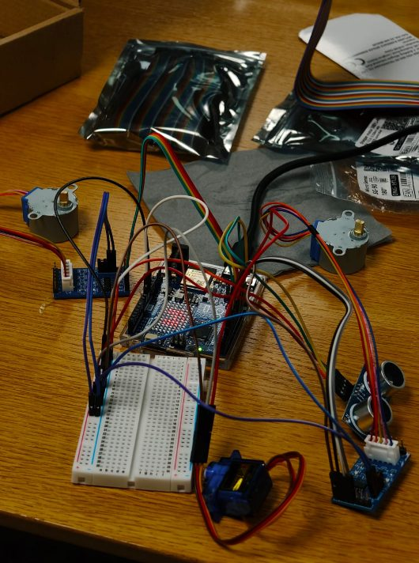<br><sub>Electronics test bench</sub></td>
    <td align="center">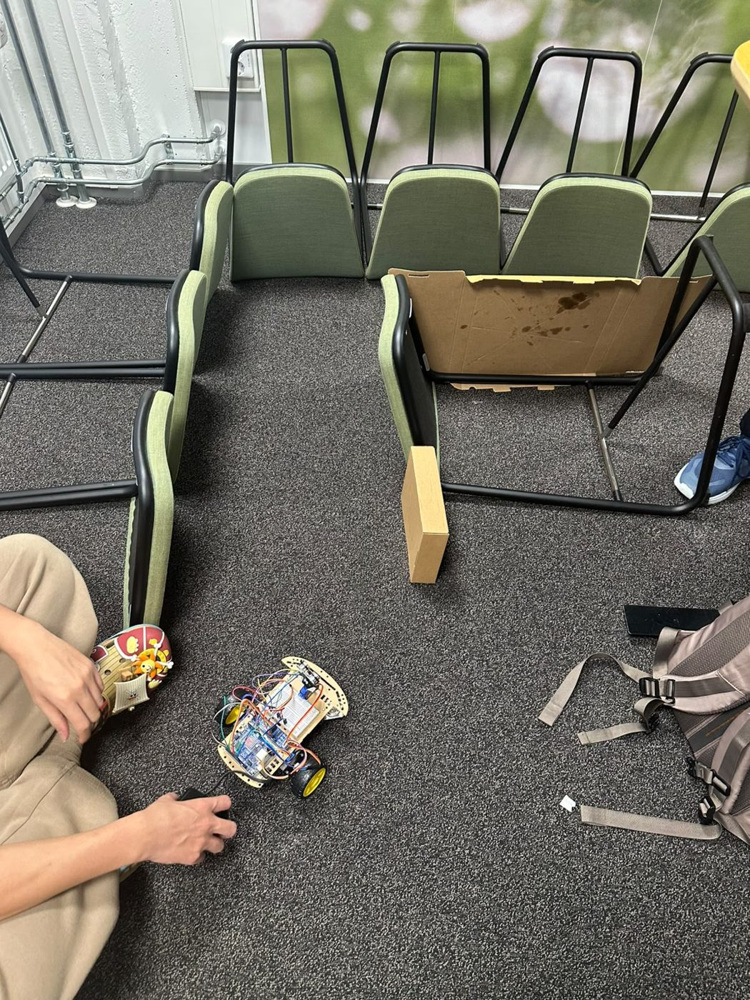<br><sub>Testing in a chair obstacle course</sub></td>
  </tr>
  <tr>
    <td align="center"><a href="videos/rover_drive_test.mp4">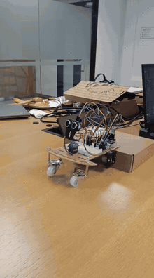</a><br><sub>▶️ Drive test</sub></td>
    <td align="center"><a href="videos/dashboard_control.mp4">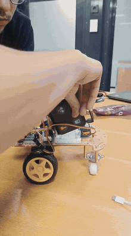</a><br><sub>▶️ Driving from the dashboard</sub></td>
  </tr>
</table>
<p align="center"><sub>Click a clip to watch the full video.</sub></p>
</details>

<details open>
<summary><h3>🟩 Day 3 · Sunday 11.10: Back to prototype 1</h3></summary>

Since we ran out of time, the servo rebuild got pushed to day 3. We finished the new prototype in a few hours and immediately ran into a new issue: apparently the servos would return to their original position after making a tiny turn. A truly groundbreaking issue. We spent a good 2 hours trying to fix it, then gave up and switched back to prototype 1, the one that worked on day 2.

With only 4 hours left, everyone locked in and got their parts done. We made it just in time.

| Team | What they did |
|---|---|
| 🔧 Engineering | Finished the servo build, fought the servos for 2 hours, rebuilt prototype 1 |
| 🎨 Decoration | Finished the deco parts |
| 💻 Software | Got the code running on the final rover |
</details>

<a id="3d-design"></a>

## 🖨️ 3D design & printing

### 🔩 Custom parts (printed by Hieu)

Designed in OpenSCAD and printed on a Prusa MK4S.

<table>
  <tr>
    <td align="center">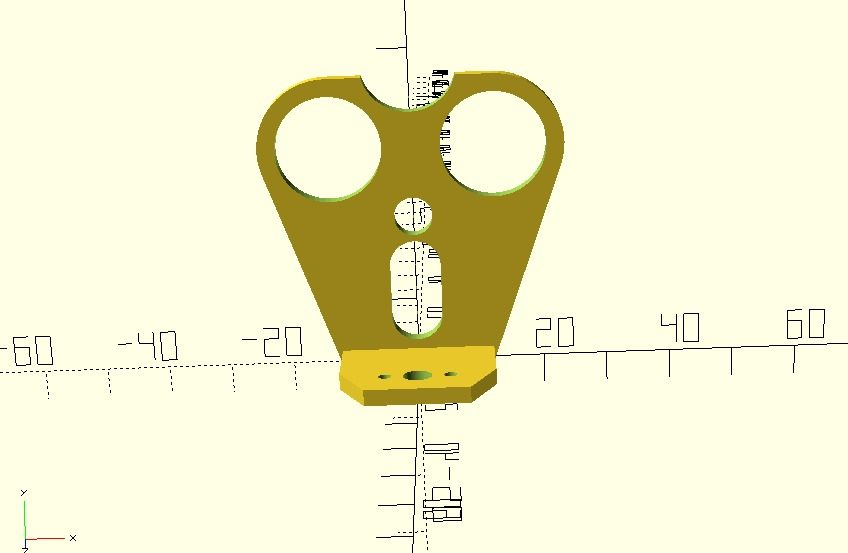<br><sub>Sensor mount</sub></td>
    <td align="center">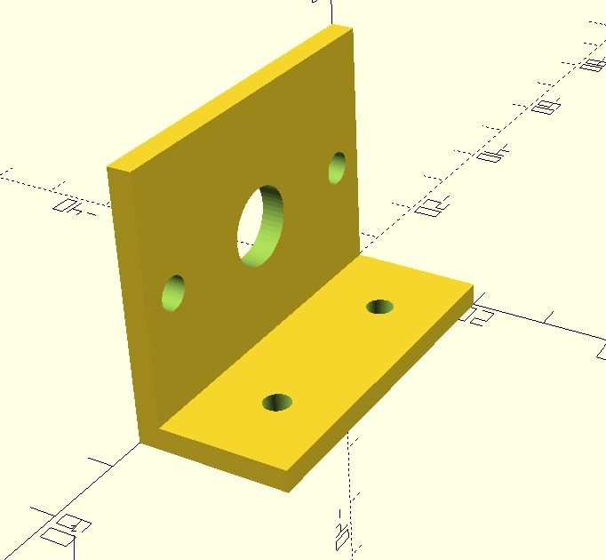<br><sub>Bracket</sub></td>
    <td align="center">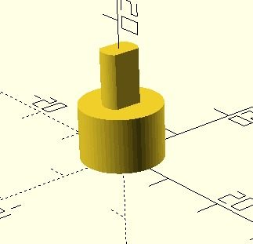<br><sub>Adapter</sub></td>
    <td align="center">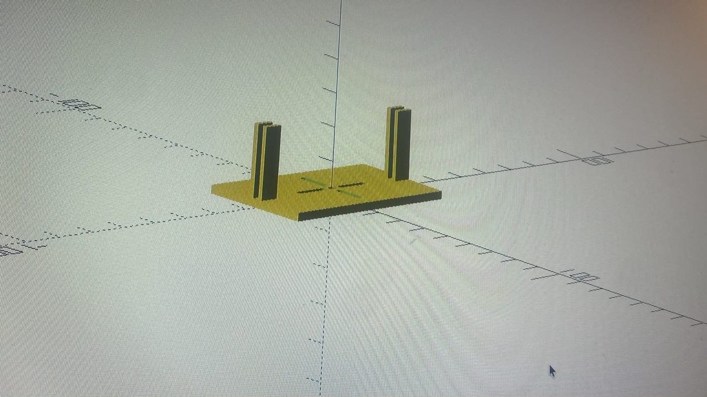<br><sub>Platform</sub></td>
  </tr>
</table>

<table>
  <tr>
    <td align="center">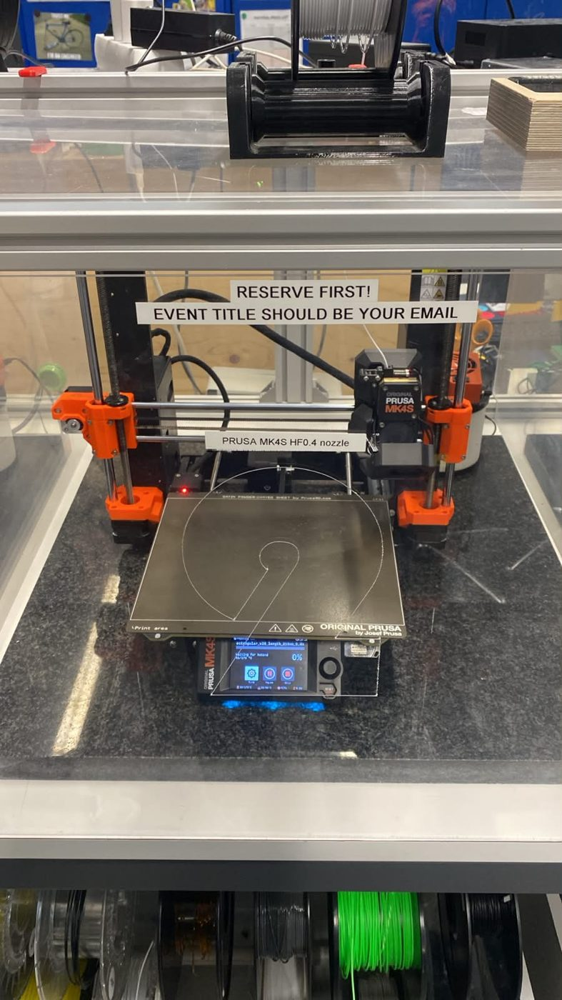<br><sub>On the printer</sub></td>
    <td align="center"><a href="videos/3d_printing.mp4">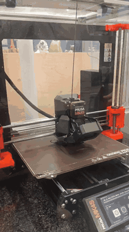</a><br><sub>▶️ Printing in action</sub></td>
  </tr>
</table>

### 🎨 Outer shell (Minh & Cuong)

Body cover that fits over the rover, designed in OpenSCAD.

<p align="center">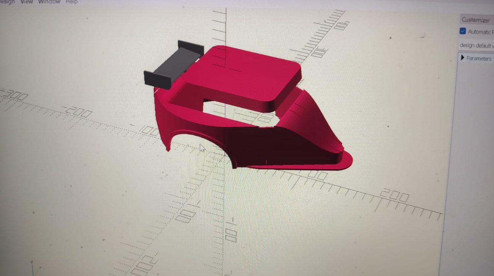</p>

## 🔮 Future work

- Camera-based object recognition
- Path memory and mapping from radar data

## 👥 Team

Six 1st and 2nd year BSc computational engineering students, the **AsianBros**, split into three teams:

| Team | Members | What they did |
|---|---|---|
| 💻 **Software** | Jason Williams, Sumaya Akter | Firmware, driving modes, Wi-Fi dashboard, voice control |
| 🔧 **Engineering** | Anik Rahman Siam, Trong Hoang | Cutting, drilling, building the body, wiring everything to the Arduino, 3D printing |
| 🎨 **Decoration** | Nhat Minh Nguyen, Le Xuan Cuong | Designed the outer shell that covers the rover in OpenSCAD |


---

<div align="center">

Made with ☕ and solder at **LUTES Deep Tech Hackathon 2026**

</div>
