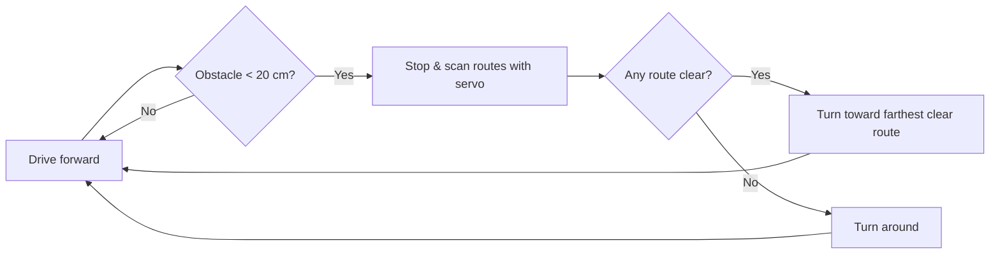

<div align="center">

# 🤖 Obstacle-Avoiding Wi-Fi Rover

**An autonomous 2WD rover that sees, decides and drives — controlled from any phone over Wi-Fi.**

*Built in 48 hours at the LUTES Deep Tech Hackathon · Challenge 1 · Oct 9–11, 2026*


<br>

<table>
  <tr>
    <td></td>
    <td></td>
  </tr>
</table>

<br>

### ▶️ Demo

https://github.com/user-attachments/assets/VIDEO_ID

<!-- If the video is on YouTube instead, use:
[](https://www.youtube.com/watch?v=YOUTUBE_ID)
-->

</div>

---

## 📌 Overview

Our rover drives on its own, detects obstacles with an ultrasonic sensor mounted on a sweeping servo, and picks the clearest path — without turning its body to look around. On top of the autonomous core we added a **live web dashboard** served directly from the board, so anyone on the same network can switch modes, drive it manually, watch a real-time radar, or talk to it with voice commands.

## ✨ Features

| Mode | What it does |
|---|---|
| 🧭 **Avoid** (default) | Drives straight until an obstacle is closer than 20 cm, scans every route with the servo, then turns toward the farthest clear path. Turns around only when all routes are blocked. |
| 🎮 **Manual** | Drive forward / back / left / right from the dashboard buttons. |
| 🎯 **Follow** | Locks onto the nearest object in front and follows it at a set distance. |
| 📡 **Radar** | Sweeps the sensor and draws a live radar on the dashboard; stale points fade out after 3 s. |
| ⛔ **Stop** | Instantly halts all motors. |
| 🎙️ **Voice** | Wake word **"rover"** + a command (e.g. *"rover, stop"*) — no push-to-talk button needed. |

## 🧰 Hardware

| Component | Role |
|---|---|
| Arduino UNO R4 WiFi | Brain + Wi-Fi web server (ESP32-S3 radio) |
| 2× MG996R continuous-rotation servos | Drive wheels |
| HC-SR04 ultrasonic sensor | Distance measurement (2–400 cm) |
| SG90 servo | Pans the sensor to scan routes |
| 2WD chassis kit + caster | Frame |
| Custom outer shell | Body cover designed by the decoration team |
| 2× 18650 cells / USB power bank | Motor and logic power |

### 🔌 Pin map

| Part | Pins |
|---|---|
| Left wheel servo | D5 |
| Right wheel servo | D6 |
| Servo signal | D10 |
| HC-SR04 Trig / Echo | D11 / D12 |

## 🗂️ Project structure

```
rover/
├── rover.ino              # Entry point: setup() + loop()
├── config.h               # Wi-Fi name, password, fixed IP
├── src/
│   ├── core/              # Motors, sensor, servo, config
│   ├── modes/             # Avoid, Manual, Follow, Radar
│   └── web/               # Wi-Fi server + embedded dashboard.h
├── web/                   # Dashboard source (HTML / CSS / JS)
├── tools/
│   ├── build_dashboard.py # Packs web/ into src/web/dashboard.h
│   └── sensor_test/       # Standalone ultrasonic sensor test
└── backup_stepper/        # Earlier stepper-motor version
```

## 🚀 Getting started

**1. Install the toolchain**
- Arduino IDE or `arduino-cli`
- Board package: **Arduino UNO R4 Boards**

**2. Set your Wi-Fi** — edit `WIFI_SSID` and `WIFI_PASS` in `config.h` (network must be **2.4 GHz**).

**3. Build the dashboard** (only after editing files in `web/`)
```bash
python tools/build_dashboard.py
```

**4. Compile & upload**
```bash
arduino-cli compile --fqbn arduino:renesas_uno:unor4wifi .
arduino-cli upload  --fqbn arduino:renesas_uno:unor4wifi -p <PORT> .
arduino-cli monitor -p <PORT> -c baudrate=9600
```

**5. Drive it** — the Serial Monitor prints `Control page: http://...`. Open it in a browser on the same network. If the hotspot isn't found, the rover starts its own network, **RoverAP**.

## 🧠 How Avoid mode works



## 🛠️ Challenges we solved

- **Wiring vs. code mismatches** — sensor reading `-1` traced to swapped pins; we fixed one pin map as the single source of truth.
- **Rover seeing itself** — narrowed the scan angle in Follow/Radar so the chassis isn't detected as an obstacle.
- **Jittery servo** — the servo now holds still once a target is locked instead of constantly twitching.
- **Changing IP address** — assigned a fixed IP so the dashboard link stays the same between runs.
- **Motor direction & speed** — tuned direction constants until manual controls matched, then swapped the slow steppers for continuous-rotation servos.

## 📓 Log book

> 48 hours, 6 people, 1 rover — how it came together.

<p align="center">
  
  
  
  
</p>

<details open>
<summary><h3>🟦 Day 1 · Friday 9.10 — Planning</h3></summary>

| | Milestone |
|:-:|---|
| 🤝 | Team of 6 formed, picked **Challenge 1: Small Robot That Measures Distance to Obstacles** |
| ✏️ | Spent the day planning how to tackle the challenge: 2 wheels + motors + mainboard, light platform, sensor on a rotating mount, separate power for motors and sensor |
| 📦 | Got the kit: Arduino UNO R4 WiFi, 2× 28BYJ-48 + ULN2003, HC-SR04, SG90, 2WD chassis |
| 👥 | Split into 3 teams: **software**, **engineering**, **decoration** |

<p align="center"></p>
</details>

<details open>
<summary><h3>🟪 Day 2 · Saturday 10.10 — Rebuilding from scratch</h3></summary>

| | Milestone |
|:-:|---|
| 🔁 | Had to rebuild things from scratch, both hardware and code |
| 🔧 | Engineering team cut, drilled and assembled the body, then wired everything to the Arduino |
| 🎨 | Decoration team designed the outer shell that covers the rover |
| 💻 | Software team set up the toolchain and built the Wi-Fi dashboard with Stop / Avoid / Manual / Follow / Radar modes |
| 🔥 | A jumper wire heated up from reversed wiring; found it and rewired |
| 🐛 | Sensor stuck on `-1`: code pins didn't match the build. Fixed to Trig D11 / Echo D12 / servo D10 |
| 🗂️ | Restructured code into `src/core`, `src/modes`, `src/web`; split the dashboard into HTML/CSS/JS with a build script |
| 📶 | Fixed IP on the hotspot so the dashboard link stops changing |
| 🧭 | Rewrote Avoid mode: stop at 20 cm, scan with the servo only, turn toward the farthest clear route |
| 🎯 | Tuned Follow & Radar: narrower scan, steady target lock, radar dots fade after 3 s |
| 🎙️ | Added voice control with the wake word **"rover"** |
| ⚡ | Steppers hit their speed limit, so we swapped to **MG996R continuous servos** (D5/D6) and kept the stepper version in `backup_stepper/` |
| 📝 | Wrote the README |
</details>

<details open>
<summary><h3>🟩 Day 3 · Sunday 11.10 — Polish & pitch <i>(coming up)</i></h3></summary>

| | Plan |
|:-:|---|
| ⏳ | Final tuning on the servo drive |
| ⏳ | Fit the outer shell |
| ⏳ | Record the demo video |
| ⏳ | **16:30** Submit |
| ⏳ | **17:00** Pitch + live demo (5 min) and judge Q&A (3 min) |
</details>

## 🔮 Future work

- Camera-based object recognition
- Path memory and mapping from radar data

## 👥 Team

Six BSc Computer Engineering students — **AsianBros**, split into three teams:

| Team | Members | What they did |
|---|---|---|
| 💻 **Software** | Jason Williams, Sumaya Akter | Firmware, driving modes, Wi-Fi dashboard, voice control |
| 🔧 **Engineering** | Anik Rahman Siam, Trong Hoang | Cutting, drilling, building the body, wiring everything to the Arduino |
| 🎨 **Decoration** | Nhat Minh Nguyen, Le Xuan Cuong | Designed and built the outer shell that covers the rover |

---|---|
| NAME_1 | Software |
| NAME_2 | Software |
| NAME_3 | Electronics |
| NAME_4 | Electronics |
| NAME_5 | Chassis |
| NAME_6 | Chassis |

---

<div align="center">

Made with ☕ and solder at **LUTES Deep Tech Hackathon 2026**

</div>
